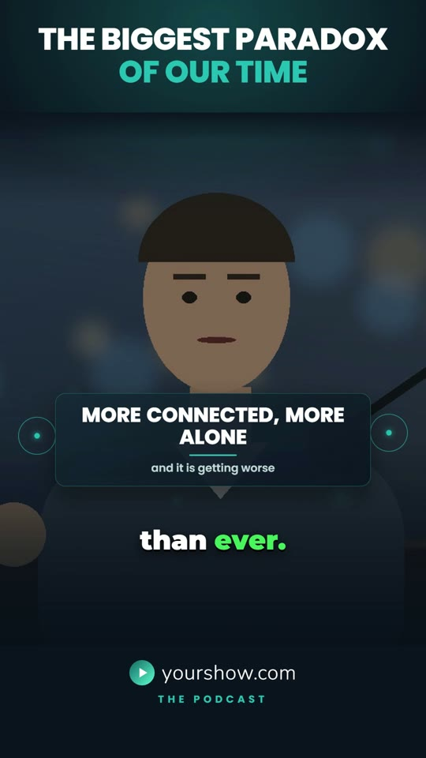
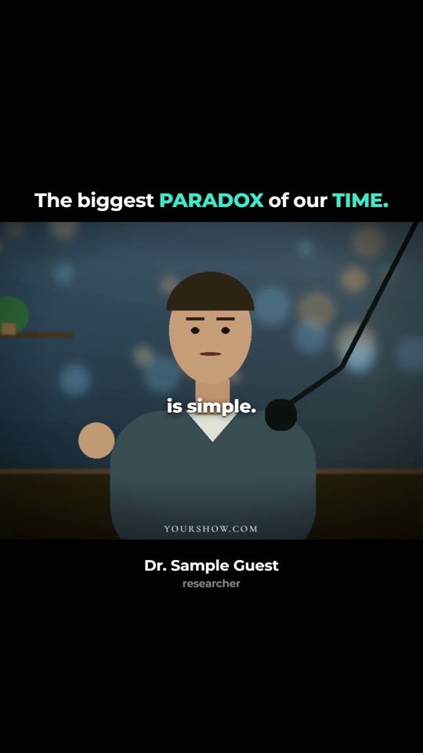
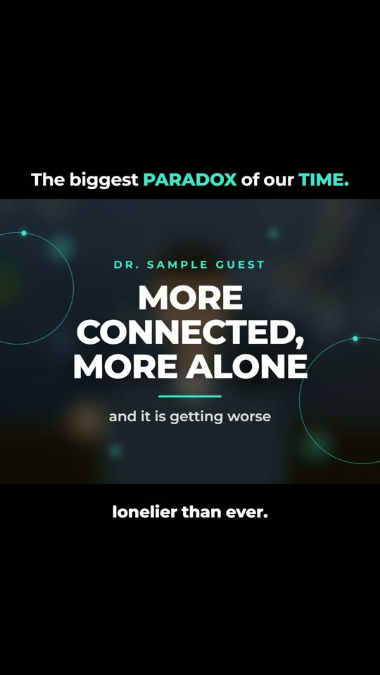
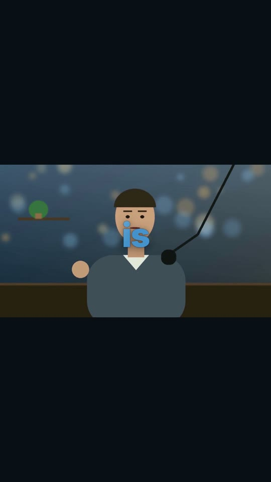
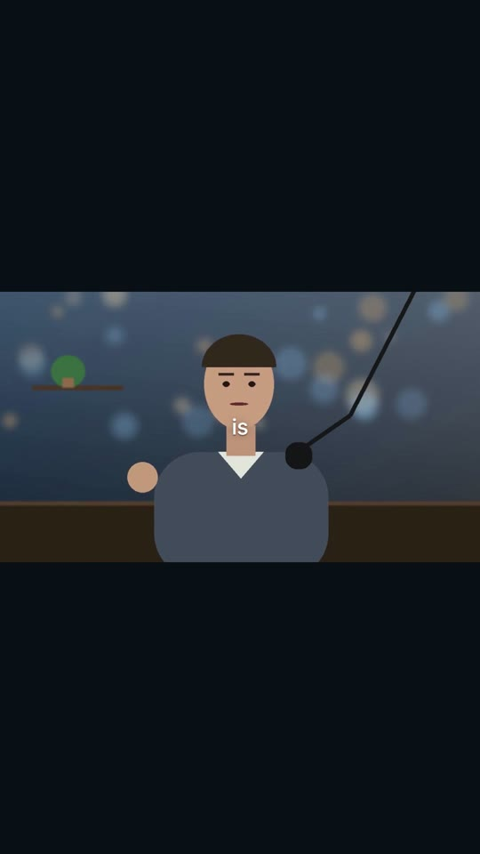
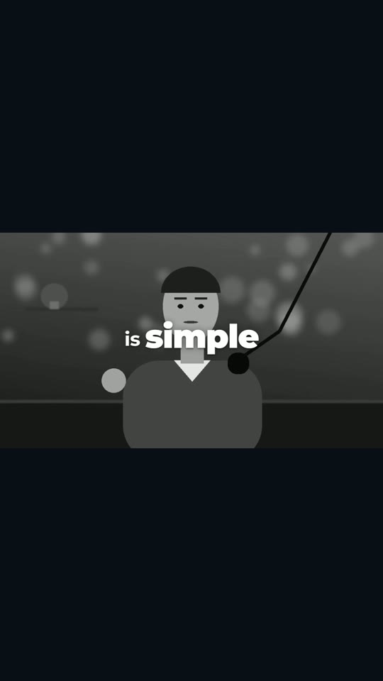
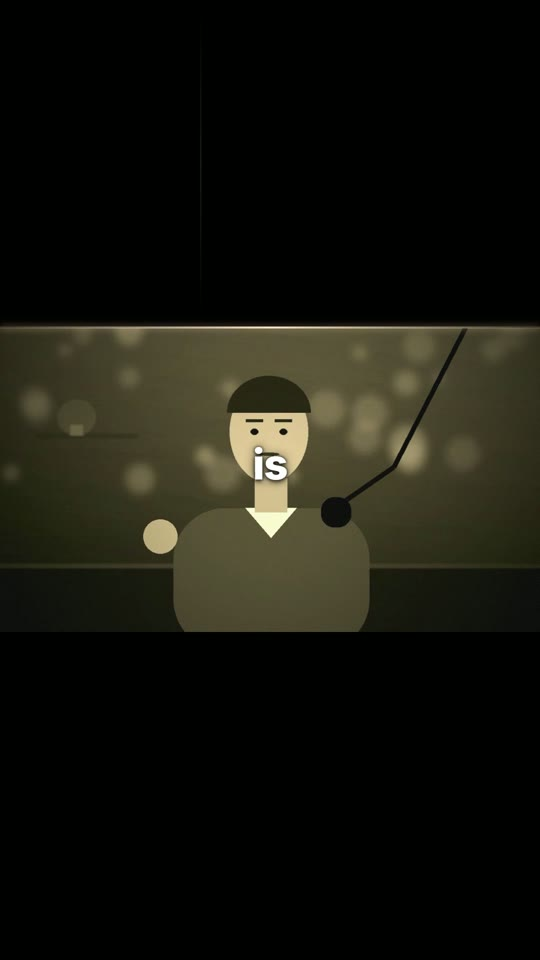

# claude-video-editor

**Turn long podcast episodes into finished, on-brand short-form videos — with Claude as the editor.**

claude-video-editor is a small, scriptable editing system built to be driven by [Claude](https://claude.com/claude-code)
(or by you from the command line). It takes raw episodes, cuts the strongest moments on word boundaries, reframes
them around the speaker, adds animated captions, motion graphics and ducked music, renders every short in several
formats, and gives you an editor-style **review timeline** where you leave time-stamped notes for the next revision.

It grew out of a real production workflow (a weekly interview podcast and client work) and encodes the rules that
came out of many rounds of feedback — see [`docs/EDITING-RULES.md`](docs/EDITING-RULES.md).

## What you get

| Step | Command | What happens |
|---|---|---|
| Transcribe | `cve transcribe <proj> --all` | faster-whisper `large-v3`, word-level timestamps, any language |
| Cut | `cve cut <proj>` | segments snapped to word boundaries, 1280x720/30 fps, loudness-normalised |
| Reframe | `cve crop <proj>` | shot-cut detection + face tracking with a dead-zone camera → smooth 4:5 crop |
| Build | `cve build <proj>` | HyperFrames compositions for every look and format |
| Music | `cve music <proj>` | picks the part of your track that builds, ducks it under speech (-15 dB), lifts it in pauses |
| Render | `cve render <proj>` | headless-Chrome render, -14 LUFS master, previews |
| Review | `cve timeline <proj>` | `timeline.html`: preview + tracks + notes you paste back to Claude |
| Verify | `cve verify <proj>` | re-transcribes every clip and diffs it against the captions |
| Plan | `cve plan words.json out.html` | scene planner for talking-head reels (captions / UI / half / full screen) |
| Styles | `cve styles` / `cve gallery` | list the edit styles / open the picker page with reference images |

`cve all <proj>` runs cut → crop → build → music → render → timeline.

### Styles — pick how Claude edits your video

Every edit style is a folder in [`styles/`](styles/) with a reference image, a description and its own template.
Run `python cve.py gallery` to open a picker page, or just ask Claude *"show me the styles"*.

| | Style | Looks like | Best for |
|---|---|---|---|
|  | **Clean Podcast** `clean-podcast` | brand bands, two-line hook, face-tracked panel, karaoke captions, lower-half cards, logo strip | interview podcasts, advice, compilations |
|  | **Cinema Bars** `cinema-bars` | black bars, one-line title with accent words, 4:3 video with slow push-in, clean white captions | emotional or thoughtful moments, quotes |
|  | **Cinema Bars + Full-frame Graphics** `cinema-bars-fullframe` | Cinema Bars plus big kinetic graphics inside the frame over the blurred shot | compilations, key numbers and named ideas |
|  | **One Word** `one-word` | dark letterbox, full 16:9 shot, one huge word at a time filled with a moving blue texture | punchy statements, big-name podcast clips |
|  | **One Word Minimal** `one-word-minimal` | dark letterbox, one small clean white word at a time | calm, emotional talks; trending sound added in the app |
|  | **Mono Emphasis** `mono-emphasis` | black & white shot, short phrases, the key word big and heavy | celebrity / expert interviews, advice with numbers |
|  | **Sepia Hype** `sepia-hype` | black letterbox, warm sepia film grade, grain, light leak, bold word pops, flash on cuts | sports and hype edits cut to a beat |
|  | **Editorial Depth** `editorial-depth` | speaker auto cut out — magazine typography (didone caps, red script, italic serif) behind and in front of the head, following it | wisdom / philosophy clips, premium channels |

Every style renders in **9:16** and, where supported, **4:5** (1080x1350) — Instagram and Facebook crop 9:16 to 4:5
in the feed, which hides titles and logos; the 4:5 versions keep everything in frame.

**Make your own:** send Claude a screenshot of an edit you like — the `style-from-reference` skill analyses it and
builds a new style folder (layout, type, colours, motion), renders a preview next to your reference and iterates.
Your styles live in `<project>/styles/` and show up in the gallery next to the built-in ones. Pull requests with new
styles are welcome.


## Takeframe — desktop AI editor (new)

[`takeframe/`](takeframe/) is a desktop video editor (Electron) where Claude builds the whole edit with these rules and skills,
and you fine-tune it on a real multi-track timeline. Select any clip and ask Claude to change only that part.
Local speech enhancement (DeepFilterNet3), voice/music separation (Demucs), Whisper transcripts, a music generator that
never repeats a style, and one-click export to MP4 in every social format, MP3, music-only, speech-only, SRT/VTT/TXT.
See [`takeframe/README.md`](takeframe/README.md).

## Install

Requirements: Python 3.10+ (MediaPipe for the speaker cut-out in `editorial-depth`), Node 18+ (for `npx hyperframes`), ffmpeg on `PATH`, optionally an NVIDIA GPU for fast transcription.

```bash
git clone https://github.com/<you>/claude-video-editor
cd claude-video-editor
pip install -r requirements.txt
python cve.py init ../my-show          # creates raw/ transcripts/ music/ final/ + example config
```

Rendering uses [HyperFrames](https://github.com/heygen-com/hyperframes) through `npx` (downloaded on first use, together
with a headless Chrome). Offline / locked-down machines: put `gsap.min.js` in `vendor/` (from `npm i gsap`) and set
`PRODUCER_HEADLESS_SHELL_PATH` to an existing `chrome-headless-shell`.

## Quick start

1. Copy episodes into `my-show/raw/` and run `python cve.py transcribe ../my-show --all`.
2. Set your brand in `my-show/project.json` (name, tagline, colours, `logo.svg`, host name, language).
3. Describe the shorts in `my-show/shorts.json` — or ask Claude to find the moments (see `skills/podcast-to-shorts`).
4. `python cve.py all ../my-show`
5. Open `my-show/timeline.html`, add notes where something is off, click **Copy notes**, paste them to Claude.

### shorts.json

```json
{
  "id": "s01", "name": "biggest-paradox",
  "hook": ["THE BIGGEST PARADOX", "OF OUR TIME"],
  "btitle": "The biggest *PARADOX* of our *TIME.*",
  "who": "Dr. Guest Name", "role": "anthropologist",
  "segs": [["episode-12", 1564.3, 1604.4]],
  "txt": ["Corrected caption text, exactly as spoken."],
  "gfx": [["paradox", "THE BIGGEST PARADOX", ""], ["epidemic", "WHO", "declared an epidemic of loneliness"]],
  "music": "calm-piano.mp3", "cx": [840], "styles": ["clean-podcast", "cinema-bars"]
}
```

* `segs`: `[episode-key, start, end]` (+ `who`, `role` per segment for compilations, with `"comp": true`).
* `txt`: corrected captions per segment — timings come from the transcript, wording from you.
* `gfx`: `[trigger word, title, subtitle]` — the card appears when the trigger word is spoken.
* `cx`: horizontal centre (0–1280) of the person to follow when several faces are in shot.
* `styles`: which styles to render this short in (default: `styles` in `project.json`).
* `music`: a file in `music/`, or `"none"` for speech only (add a trending sound in the Instagram / TikTok app — better reach, no rights problems).
* `*word*` in `btitle` = accent colour in the Cinema Bars styles.

## Using it with Claude

The repo is built to be operated by an agent. `CLAUDE.md` is the operating guide (pipeline, verification loop,
feedback loop) and `skills/` contains ready-to-install Claude skills:

* **pick-a-style** — shows the style catalog with reference images and asks which look to use.
* **style-from-reference** — builds a new style from a screenshot or reel you like.
* **podcast-to-shorts** — podcast → package of shorts, end to end.
* **edit-review** — turn pasted timeline notes into fixes and new permanent rules.
* **talking-head-reel** — talking-head reels: cut silences, plan scenes, motion graphics, sound design (with a starter SFX library).

Copy a skill folder into `~/.claude/skills/` (or your project's `.claude/skills/`).

### Works well alongside

* [nateherkai/herk-edit-kit](https://github.com/nateherkai/herk-edit-kit) is a HyperFrames editing kit. It covers silence and mistake cuts, short-form planning, motion-graphics card libraries and beat-synced showreels.
* [nateherkai/human-speak](https://github.com/nateherkai/human-speak) removes AI-sounding phrasing from titles, descriptions and captions.
* [ArtCraft](https://getartcraft.com/apps) is a suite of 13 apps (FilmCraft, EffectCraft, PhotoCraft, SoundCraft and others). Every app has a CLI and an MCP server. See [docs/artcraft.md](docs/artcraft.md).
* [aljaz13223/marox-ai](https://github.com/aljaz13223/Marox-ai) collects all of the above plus more skills in one place.

## Notes on content and licences

The code and templates are MIT licensed. Your footage, music and logos are yours — the music folder is for tracks you
own or have licensed (commercial songs will trigger Content ID claims). The included SFX are synthesized and free to use.
HyperFrames and GSAP are fetched from npm / CDN under their own licences.
